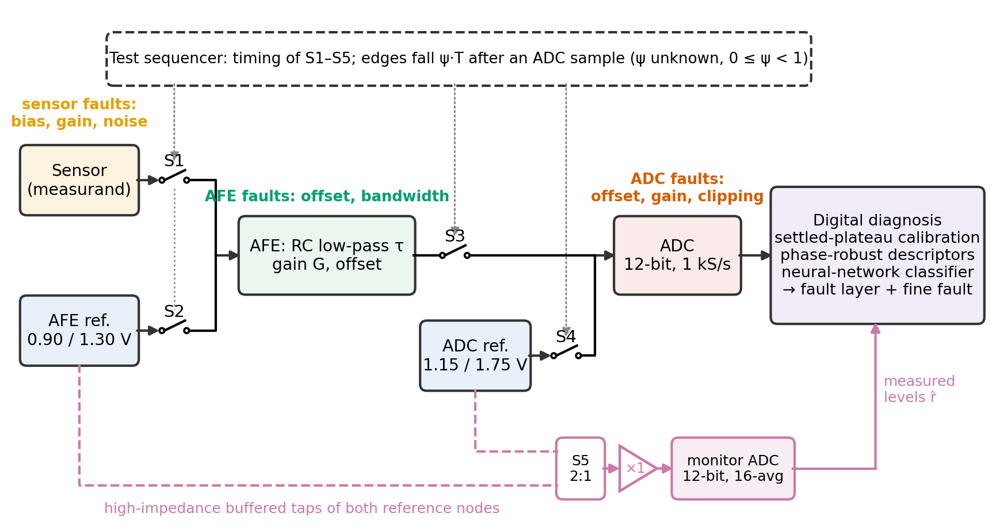
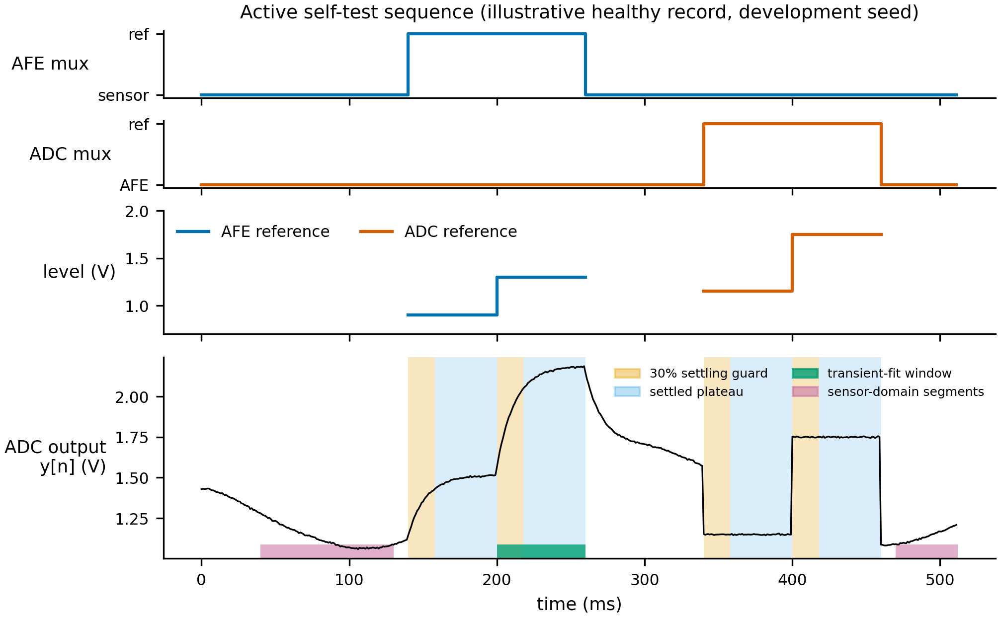
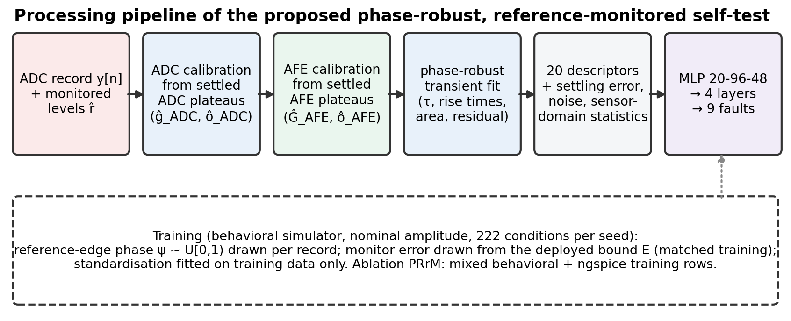
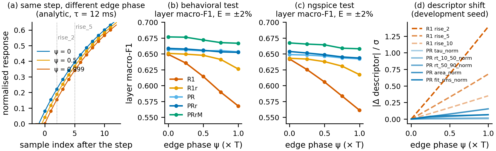
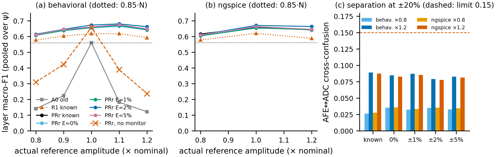
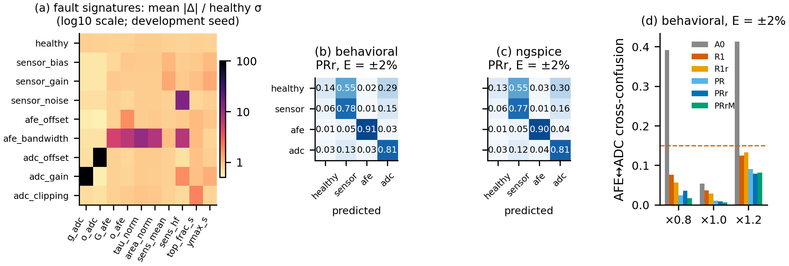
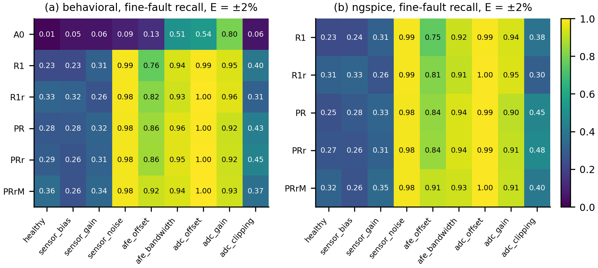
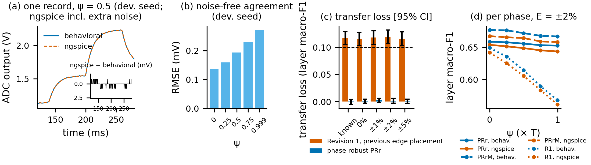
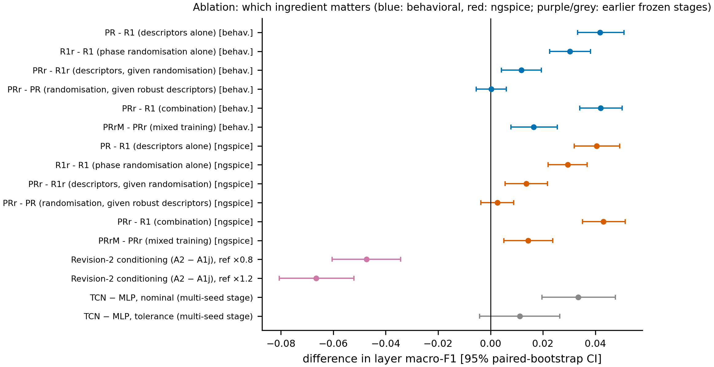

# Phase-Robust Reference-Monitored Active Self-Test of Mixed-Signal Sensor Interfaces Using Deep Learning

**[Author 1] 1, [Author 2] 1,***

1 [Affiliation, City, Country]
* Correspondence: [e-mail]

---

**Abstract:** Attributing a fault in a mixed-signal sensor interface to the sensor, the analog front-end (AFE) or the analog-to-digital converter (ADC) is ill-posed from the output signal alone. We propose an active self-test that switches two known two-level references into the chain—one replacing the sensor at the AFE input, one bypassing the AFE at the ADC input—so that AFE and ADC transfer errors become separately observable. A high-impedance monitor channel measures the reference levels, settled-plateau calibration estimates both transfer functions against them, and phase-robust transient descriptors from a whole-window fit with a free edge time remove the dependence on the unknown phase between reference edges and ADC samples. A compact neural network (6,868 parameters) classifies the faulty layer and nine fault classes. In a pre-registered simulation study with three unseen dataset seeds and paired behavioral and ngspice test sets including tolerances, noise and 12-bit quantisation, the method retained ≥91.6% of nominal layer macro-F1 under ±20% reference-amplitude changes and ≥92.4% with a ±5% monitor error, kept AFE–ADC cross-confusion ≤0.089, varied by ≤0.011 across sampling phases (fixed-sample descriptors: 0.081) and lost 0.002 (95% CI -0.003 to 0.006) from behavioral to ngspice data, versus 0.119 before. Results are simulation-only.

**Keywords:** built-in self-test; mixed-signal sensor interface; fault diagnosis; reference monitor; analog front-end; ADC calibration; sampling phase; neural network; ngspice

---

## 1. Introduction

Sensor systems increasingly have to report not only a measurement but also whether that measurement can be trusted. In a typical interface the physical sensor is followed by an analog front-end (AFE) that filters and amplifies the signal and by an analog-to-digital converter (ADC). A fault in any of the three layers changes the digitised signal, but the location of the fault determines the corrective action: a drifting sensor must be recalibrated or replaced, whereas an AFE or ADC fault is an electronics problem. Built-in self-test (BIST) for analog and mixed-signal circuits and data-driven fault diagnosis of electronic circuits are established research areas [REF-1: mixed-signal / MEMS BIST review], [REF-2: neural-network fault diagnosis of analog circuits], [REF-3: on-line sensor fault detection]. However, the specific problem of attributing a fault to the sensor, the AFE or the ADC from a single digitised output remains ill-posed when only passive data are available.

The difficulty is one of identifiability. For a linear chain observed at its output, $y = g_\mathrm{ADC}\,(G_\mathrm{AFE}\,x + o_\mathrm{AFE}) + o_\mathrm{ADC}$, only the composite gain $g_\mathrm{ADC} G_\mathrm{AFE}$ and the composite offset are observable; an AFE gain error and an ADC gain error with the same product produce identical outputs. A single test stimulus injected before the AFE does not change this. A second, known stimulus that bypasses the AFE does: it measures the ADC transfer alone, after which the AFE transfer follows from the first stimulus. We therefore use an electronic two-point self-test with two reference-replacement paths.

Two practical problems appear when this architecture is combined with a learned classifier, and both were found during the staged, pre-registered validation of this work (Appendix A). First, if the reference amplitude changes and the classifier is not told so, a rescaled reference is indistinguishable from an ADC gain or offset fault; in our earlier frozen test this made almost every sample look like an ADC fault. Second, transient descriptors read at fixed samples after a reference step depend on where the reference edge falls between two ADC samples. This sampling phase is not controlled in practice, and in our previous behavioral-to-circuit-simulation test the resulting mismatch cost 0.119 in layer macro-F1 (95% CI 0.107–0.132), above our pre-registered limit of 0.10.

To the best of our knowledge—pending a systematic literature search, which we have not yet completed [REF-4…]—the combination studied here has not been reported: (i) two physically separated reference-replacement points chosen from an identifiability argument, (ii) a monitored reference path, (iii) sampling-phase-robust transient descriptors and (iv) a neural-network classifier evaluated under unseen operating conditions and in two simulation domains. The contributions of this paper are:

1. an electronic **two-point active self-test** that makes AFE and ADC faults separable (Section 2);
2. **settled-plateau calibration** and **phase-robust transient descriptors** that are invariant to the reference amplitude and to the sampling phase of the reference edge (Section 3);
3. an electronic **reference-monitor path** that compensates known reference drift, evaluated with 0%, ±1%, ±2% and ±5% monitor gain error (Sections 2.3 and 4.2);
4. a compact **neural-network classifier** for layer-level (healthy/sensor/AFE/ADC) and nine-class fault diagnosis (Section 3.4);
5. a **pre-registered behavioral-to-ngspice validation** across reference amplitudes, sampling phases, component tolerances, noise and ADC quantisation, with ablations that identify which ingredient is responsible for the robustness (Sections 4 and 5).

Section 2 describes the electronic architecture, Section 3 the descriptors, classifier and simulation protocol, Section 4 the results, Section 5 the ablations, and Section 6 the limitations.

## 2. Electronic System Architecture

### 2.1. Measurement Chain and Fault Model

The interface (Figure 1) consists of a sensor, an AFE modelled as a first-order RC low-pass filter with time constant $\tau$ followed by a gain $G$ and an offset, and a 12-bit ADC sampling at 1 kS/s. Each operating condition draws its own baseline, signal amplitude and frequency, sensor noise, AFE gain and AFE time constant (Table 1), so the classifier is always tested on operating conditions it has not seen. Nine fault classes are simulated: healthy; sensor bias, gain and excess noise; AFE offset and bandwidth (time constant) faults; and ADC offset, gain and clipping faults (Table 1).

**Table 1.** Simulation and circuit parameters (code constants).

| item | value | source |
|---|---|---|
| Sampling | 1 kHz, 512 samples per record (0.512 s), 12-bit ADC over 0-3.3 V, ADC noise 2.5 mV rms | src/simulate.py: simulate_sample |
| Operating condition (per group) | baseline U(0.78,1.18) V; carrier amplitude U(0.045,0.18) V; frequency U(0.45,3.0) Hz; sensor noise U(2,14) mV; AFE gain U(1.65,2.05); AFE tau U(8,16) ms; slow component 25 mV at 0.12 Hz; random-walk drift 1.5 mV/step | src/simulate.py: make_condition, _base_signal |
| AFE reference window | 140-260 ms; 0.90 V then 1.30 V (two 60 ms plateaus); replaces the sensor at the AFE input | src/simulate.py: _afe_reference |
| ADC reference window | 340-460 ms; 1.15 V then 1.75 V; bypasses the AFE at the ADC input | src/simulate.py: _adc_reference |
| Faults (severity) | sensor bias / AFE offset / ADC offset: ±U(0.06,0.24) V; sensor gain / ADC gain: ±U(6,28)%; sensor noise: U(25,95) mV rms; AFE bandwidth: tau x U(1.8,4.5); ADC clipping: full scale x U(0.72,0.93) | src/simulate.py: make_fault |
| Component tolerances (test, both domains) | AFE gain ±5%, AFE tau ±10%, ADC gain ±2%, ADC offset ±10 mV, sensor baseline ±5% (uniform per sample) | src/run_reference_monitor.py: _draw_tol |
| Reference amplitude | x0.8, 0.9, 1.0, 1.1, 1.2 of nominal (behavioral); x0.8, 1.0, 1.2 (ngspice) | phase_robust_final/PROTOCOL_PHASE_ROBUST_FROZEN.md, section 3 |
| Edge phase | psi in {0, 0.25, 0.5, 0.75, 0.999} of one sampling period (test); U[0,1) per sample (training, randomised arms) | phase_robust_final/PROTOCOL_PHASE_ROBUST_FROZEN.md, sections 1 and 3 |
| Reference monitor | buffered 12-bit channel, 16-sample mean, 0.25 mV rms after averaging, common gain error U(-E,E), E in {0,1,2,5}% | src/monitor_model.py |
| ngspice-only noise | 0.5 mV rms amplifier-input noise and 0.5 mV rms on each reference rail | src/spice_domain.py: AMP_NOISE_V, REF_NOISE_V |
| Switch model (ngspice) | Ron = 0.5 Ohm, Roff = 1 MOhm, threshold 2.5 V, hysteresis 0.1 V; 1 us edges | src/spice_phase.py: render_phase |

*Source: src/simulate.py; src/monitor_model.py; src/spice_domain.py; src/spice_phase.py; src/run_reference_monitor.py.*

**Figure 1.** Electronic architecture. Switches S1/S2 replace the sensor by the AFE reference; S3/S4 replace the AFE output by the ADC reference; S5 and the buffered monitor ADC measure the reference levels. Fault locations are marked. Source: drawn by `src/paper_figures.py::fig_architecture` (schematic, not a result).

### 2.2. Two-Point Reference Multiplexer

During the AFE test window the AFE input is connected to a two-level reference $r^\mathrm{AFE}_1 \rightarrow r^\mathrm{AFE}_2$ (nominally 0.90 V and 1.30 V); during the ADC test window the ADC input is connected to a second two-level reference $r^\mathrm{ADC}_1 \rightarrow r^\mathrm{ADC}_2$ (nominally 1.15 V and 1.75 V) that bypasses the AFE. Writing the settled ADC outputs on the two ADC plateaus as $m_1, m_2$,

$$\hat g_\mathrm{ADC} = \frac{m_2-m_1}{r^\mathrm{ADC}_2-r^\mathrm{ADC}_1},\qquad \hat o_\mathrm{ADC} = m_1-\hat g_\mathrm{ADC}\,r^\mathrm{ADC}_1, \tag{1}$$

which isolates the ADC. The waveform is then ADC-calibrated, $y_c[n]=(y[n]-\hat o_\mathrm{ADC})/\hat g_\mathrm{ADC}$, and the AFE transfer follows from the settled outputs $a_1,a_2$ on the AFE plateaus,

$$\hat G_\mathrm{AFE} = \frac{a_2-a_1}{r^\mathrm{AFE}_2-r^\mathrm{AFE}_1},\qquad \hat o_\mathrm{AFE} = a_1-\hat G_\mathrm{AFE}\,r^\mathrm{AFE}_1. \tag{2}$$

Gains are normalised by the reference *difference* and are therefore insensitive to a common scaling of the reference; offsets are absolute intercepts and are deliberately not normalised.

### 2.3. Reference-Monitor Circuit

Equations (1) and (2) require the actual reference levels. If the reference drifts and the nominal values are used instead, the drift is misread as an AFE or ADC fault (Section 4.2). The proposed monitor taps both reference nodes through a 2:1 switch (S5 in Figure 1) and a unity-gain buffer with an input impedance of at least 10 MΩ (loading error below 0.01%) into a dedicated 12-bit SAR ADC channel (0–3.3 V, LSB 0.806 mV). Each level is reported as the mean of 16 samples with 1 mV rms input-referred noise per sample. The monitor's gain error (its own reference and resistor tolerance) is bounded by $\pm E$ and is common to the four levels of a test; its offset is assumed trimmed:

$$\hat r = Q\!\left(r\,(1+e)+n\right),\qquad e\sim\mathcal U(-E,E),\quad n\sim\mathcal N\!\left(0,(1\,\mathrm{mV}/\sqrt{16})^2\right), \tag{3}$$

with $Q(\cdot)$ the 12-bit quantiser and $E\in\{0,1,2,5\}\%$. $E=0$ still includes noise and quantisation. The measured levels $\hat r$ replace $r$ in Equations (1) and (2). The monitor is a modelling assumption; it was not built.

### 2.4. Active Self-Test Sequence

Each 512 ms record (Figure 2) contains a passive sensor segment, the AFE test window (140–260 ms, two 60 ms plateaus), a recovery segment, the ADC test window (340–460 ms, two 60 ms plateaus) and a final sensor segment. The reference and multiplexer edges are generated by a sequencer whose clock is not phase-locked to the ADC: an edge occurs a fraction $\psi\in[0,1)$ of a sampling period $T$ after the preceding ADC sample, $t_\mathrm{edge}=t_{i-1}+\psi T$. The first sample on the new level has therefore settled for $(1-\psi)T$, and any descriptor that reads fixed samples after the edge depends on $\psi$.

**Figure 2.** Active self-test sequence: multiplexer states, reference levels and an illustrative healthy ADC record (development seed 20261097). Shaded: 30% settling guard and settled plateaus; bars: transient-fit window and sensor-domain segments. Data: `figure_data/fig02_timing_example.csv`.

## 3. Methods

### 3.1. Settled-Plateau Calibration

Each two-level window is split into its two plateaus of $L=60$ samples. The first 30% of every plateau (a guard of 18 samples, fixed before validation) is discarded and the remaining samples are averaged:

$$m_k=\frac{1}{L-\lceil 0.3L\rceil}\sum_{n=n_k+\lceil 0.3L\rceil}^{n_k+L-1} y[n],\qquad k=1,2, \tag{4}$$

and analogously $a_k$ on $y_c$. The plateau-settling errors $\varepsilon_k=(\bar y_{k,\mathrm{tail}}-a_k)/|a_2-a_1|$ (tail: last six samples) and the residual noise (standard deviation of the linearly detrended settled samples) are separate descriptors.

### 3.2. Phase-Robust Transient Descriptors

The transient of the second AFE plateau carries the bandwidth information. Revision-1 descriptors sampled it at fixed offsets (2, 5, 10, 20 and 30 samples after the step) and are therefore phase-dependent. The proposed descriptors are estimated from the whole plateau. Let $d_j=y[n_2-1+j]-y[n_2-1]$, $j=1,\dots,L$, be the response relative to the last pre-step sample, at times $u_j=jT$. The model

$$d(u)=S\left(1-e^{-(u-t_e)/\tau}\right)\mathbb 1[u\ge t_e] \tag{5}$$

has the edge time $t_e$ as a free parameter, which absorbs the unknown phase. For fixed $(\tau,t_e)$ the span has the closed-form least-squares value $S^\star=\sum_j g_j d_j/\sum_j g_j^2$ with $g_j=(1-e^{-(u_j-t_e)/\tau})\mathbb 1[u_j\ge t_e]$, and the residual is $\mathrm{RSS}=\|d\|^2-S^\star\sum_j g_j d_j$ (variable projection). $(\tau,t_e)$ are found by a deterministic grid search—56 log-spaced values of $\tau$ between 1 and 400 ms and 7 values of $t_e$ between $-0.25T$ and $1.25T$—followed by one local refinement ($\tau\times[0.9,1.1]$, $t_e\pm0.2T$, 9×9 points). The search has no convergence failure mode; a documented multi-sample fallback for a degenerate span ($|S^\star|<10^{-4}$) was triggered 0 times in 16,200 development-seed records. With $r_j=d_j/S^\star$ and plateau length $P=LT$, the five transient descriptors are

$$\frac{\tau}{P},\quad \frac{t_{50}-t_{10}}{P},\quad \frac{t_{90}-t_{50}}{P},\quad A=\frac{T}{P}\sum_j(1-r_j),\quad \rho=\frac{\sqrt{\mathrm{RSS}/L}}{|S^\star|}, \tag{6}$$

where $t_q$ is the time at which the monotone envelope of $r_j$ crosses $q\%$ (linear interpolation, capped at the window end). Rise-time *differences* are shift-invariant, and all five quantities are invariant to the ADC gain and offset and to the monitored levels. The edge time $t_e$ itself is not used, because it only encodes the phase. On the development seed, moving $\psi$ from 0 to 0.999 shifted the Revision-1 descriptor `rise_2` by 1.39 standard deviations, but no phase-robust descriptor by more than 0.15 ($\tau/P$: 0.00) (Figure 4d).

The full processing chain is summarised in Figure 3. The complete phase-robust vector has 20 entries: ADC gain, offset and noise; AFE gain, offset, two settling errors and noise; the five transient descriptors; five sensor-domain statistics of the fully calibrated waveform outside the test windows (mean, standard deviation, high-frequency noise, peak-to-peak and slope); and two saturation descriptors (maximum level and top-of-range fraction) (Appendix B).

**Figure 3.** Processing pipeline. Source: drawn by `src/paper_figures.py::fig_pipeline`.

### 3.3. Arms Compared

The arms compared are listed in Table 2.

**Table 2.** Arms compared (all use the same MLP; monitored variants are trained with the matching monitor error).

| arm | descriptors | training phase | training domain | role |
|---|---|---|---|---|
| A0 | old descriptors: 96 raw samples + 38 descriptors | ψ = 0 | behavioral | previous method; also passive, single-probe, AFE-only, ADC-only baselines |
| R1 | Revision-1 (settled plateaus, fixed-sample rise fractions) | ψ = 0 | behavioral | descriptor ablation |
| R1r | Revision-1 | ψ ~ U[0,1) | behavioral | randomisation ablation |
| PR | phase-robust (whole-window transient fit) | ψ = 0 | behavioral | descriptor ablation |
| PRr | phase-robust | ψ ~ U[0,1) | behavioral | **primary method** |
| PRrM | phase-robust | ψ ~ U[0,1) | behavioral + ngspice | mixed-domain ablation |
| control | PRr known-reference model given nominal levels | — | — | no-monitor control |

*Source: phase_robust_final/PROTOCOL_PHASE_ROBUST_FROZEN.md, section 3.*

### 3.4. Neural-Network Classifier

The classifier is a fully connected multilayer perceptron with two hidden layers (96 and 48 ReLU units) on the standardised 20-dimensional descriptor vector, trained with Adam (learning rate $8\times10^{-4}$, batch 64, L2 penalty $10^{-4}$, early stopping on an internal 15% split, at most 700 epochs). Two networks are trained: one for the four fault layers and one for the nine fault classes. The layer network has 6,868 parameters and 6,720 multiply-accumulates per inference; the fault network has 7,113 parameters (Table 12). Standardisation is fitted on training data only. In the primary method (PRr) each training record draws a random edge phase $\psi\sim\mathcal U[0,1)$, and the monitor error of the training data is drawn from the same bound $E$ as at deployment (matched training; the monitor specification is a design parameter, not a test-set choice). A temporal convolutional network evaluated in an earlier frozen stage on the older descriptors was not consistently better than this MLP (Section 5) and is not used here.

### 3.5. Simulation Protocol

**Behavioral simulator.** Records are generated at 1 kS/s with the operating-condition and fault distributions of Table 1, ADC noise of 2.5 mV rms and 12-bit quantisation. The reference edge phase is implemented exactly: in the sample interval containing an edge the first-order AFE is advanced in two steps,

$$y_\mathrm{mid}=x_{i-1}+(y_{i-1}-x_{i-1})e^{-\psi T/\tau},\qquad y_i=x_i+(y_\mathrm{mid}-x_i)e^{-(1-\psi)T/\tau}, \tag{7}$$

which reduces to the standard zero-order-hold update for $\psi=0$.

**ngspice simulator.** Every ngspice test sample is a separate netlist of the circuit of Figure 1: the sensor waveform as a piecewise-linear source, the reference levels and switch controls as piecewise-linear sources with 1 µs edges placed at $t_{i-1}+\psi T$, voltage-controlled switches ($R_\mathrm{on}=0.5\,\Omega$, $R_\mathrm{off}=1\,\mathrm{M}\Omega$), the RC filter, behavioural gain/offset stages and an ADC input clamp for the clipping fault. Additional 0.5 mV rms noise is added at the amplifier input and on each reference rail. ADC noise and 12-bit quantisation are applied to the ngspice output with the same random stream as the behavioral model, so the two domains are paired sample by sample. Without the extra noise the two domains agree to 0.14–0.27 mV mean RMS per phase (worst sample 2.8 mV; development seed, Figure 8b). The fixed netlist itself had earlier been checked against the behavioral model: replacing ramped reference sources by steps reduced the ADC-output RMSE from 162 mV to 7.7 mV.

**Test conditions.** All test sets include component tolerances (AFE gain ±5%, AFE time constant ±10%, ADC gain ±2%, ADC offset ±10 mV, sensor baseline ±5%, drawn per sample), shared between the domains. Behavioral tests cover reference amplitudes ×0.8–×1.2 in steps of 0.1 and edge phases $\psi\in\{0,0.25,0.5,0.75,0.999\}$; ngspice tests cover ×0.8, ×1.0 and ×1.2 with the same five phases (13,878 ngspice runs per seed, 41,634 in total). $\psi=0.999$ reproduces the edge placement that caused the earlier transfer failure. Behavioral training data use the nominal amplitude and no tolerances; the ngspice training rows of the mixed-training ablation (PRrM) use the nominal amplitude with tolerances and the extra noise.

**Data and splits.** Three new dataset seeds (20261026, 20261027, 20261028) were used, each with 350 operating conditions × 9 faults, split by operating condition into 222 training, 40 validation and 88 test conditions with no overlap (Table 3). Two initialisation seeds were averaged per model.

**Table 3.** Validation datasets and splits.

| dataset seed | conditions (train/val/test) | test samples per behavioral cell | ngspice runs | condition overlap |
|---|---|---|---|---|
| 20261026 | 222/40/88 | 792 | 13878 | 0 |
| 20261027 | 222/40/88 | 792 | 13878 | 0 |
| 20261028 | 222/40/88 | 792 | 13878 | 0 |

*Source: phase_robust_final/phase_robust_results/seed_*/meta.json.*

### 3.6. Pre-Registration and Statistics

The protocol, descriptor definitions, arms, test grids, thresholds and decision rule were written to a frozen protocol file (with source-code hashes) before the validation seeds were generated. Development and debugging used separate seeds only. Seven criteria were pre-registered for the primary method (Table 4): A, retention ≥ 0.85·N at ±20% reference amplitude (known or monitored reference, $E\le2\%$), where N is the nominal-amplitude, known-reference layer macro-F1 of the same method in the same domain; B, superiority over the old method and the one-point baselines; C, AFE–ADC cross-confusion below 0.15; D, retention ≥ 0.70·N at $E=\pm5\%$; E, behavioral-to-ngspice transfer loss ≤ 0.10; F, every claimed improvement supported by a paired bootstrap confidence interval; G, layer macro-F1 range over the five phases ≤ 0.05. Confidence intervals come from a condition-level paired cluster bootstrap with 5000 resamples, applied per seed; the pooled interval is that of the mean of the three per-seed differences. AFE–ADC cross-confusion is the fraction of AFE- and ADC-fault samples assigned to the other of the two layers.

## 4. Results

The primary method (phase-robust descriptors with phase-randomised training, PRr) met every pre-registered criterion in both domains (Table 4). Its nominal layer macro-F1 was N = 0.659 (behavioral) and 0.660 (ngspice).

**Table 4.** Pre-registered gates for the primary method (PRr).

| gate | criterion | behavioral | ngspice | margin |
|---|---|---|---|---|
| A | ≥ 0.85·N at ×0.8 and ×1.2 (known, E ≤ 2%) | PASS | PASS | worst retention 0.916 |
| B | beats old method and one-point baselines (CI lower bound > 0) | PASS | — | smallest CI lower bound +0.112 (70 comparisons) |
| C | AFE–ADC cross-confusion < 0.15 at ×0.8 and ×1.2 | PASS | PASS | largest 0.089 |
| D | ≥ 0.70·N at E = ±5% | PASS | PASS | worst retention 0.924 |
| E | behavioral → ngspice loss ≤ 0.10 (E = ±2%) | PASS | — | 0.002 [-0.003, 0.006] |
| F | improvements supported by paired 5000-resample bootstrap CIs | — | — | applied to B and all attribution claims |
| G | layer macro-F1 range over five phases ≤ 0.05 (known, E = ±2%) | PASS | PASS | largest range 0.011 |

*Source: phase_robust_final/phase_robust_results/decision_rules.json (gates, A-G details).*

### 4.1. Sampling-Phase Sensitivity of Fixed-Sample Descriptors

With Revision-1 descriptors and training at $\psi=0$, layer macro-F1 fell from 0.649 at $\psi=0$ to 0.568 at $\psi=0.999$ (behavioral; range 0.081; ngspice range 0.081) (Table 5, Figure 4). The phase-robust method varied by 0.006 (behavioral) and 0.010 (ngspice). This is the mechanism behind the earlier transfer failure. In the earlier stage, a post-hoc development-seed test moved the ngspice edges onto the behavioral timing convention and the ngspice score rose from 0.557 to 0.625 (behavioral 0.638), with the `rise_2` shift dropping from 1.37 σ to near zero.

**Table 5.** Layer macro-F1 per sampling phase (monitor E = ±2%, pooled over amplitudes).

| domain | arm | ψ=0 | ψ=0.25 | ψ=0.5 | ψ=0.75 | ψ=0.999 | range |
|---|---|---|---|---|---|---|---|
| behavioral | A0 | 0.279 | 0.279 | 0.281 | 0.281 | 0.282 | 0.003 |
| behavioral | R1 | 0.649 | 0.636 | 0.614 | 0.590 | 0.568 | 0.081 |
| behavioral | R1r | 0.651 | 0.650 | 0.648 | 0.641 | 0.626 | 0.025 |
| behavioral | PR | 0.657 | 0.656 | 0.655 | 0.655 | 0.653 | 0.004 |
| behavioral | PRr | 0.659 | 0.658 | 0.656 | 0.653 | 0.652 | 0.006 |
| behavioral | PRrM | 0.677 | 0.676 | 0.672 | 0.668 | 0.667 | 0.010 |
| ngspice | R1 | 0.642 | 0.625 | 0.606 | 0.584 | 0.561 | 0.081 |
| ngspice | R1r | 0.643 | 0.642 | 0.638 | 0.631 | 0.617 | 0.026 |
| ngspice | PR | 0.649 | 0.648 | 0.647 | 0.644 | 0.642 | 0.007 |
| ngspice | PRr | 0.654 | 0.651 | 0.649 | 0.645 | 0.643 | 0.010 |
| ngspice | PRrM | 0.667 | 0.665 | 0.664 | 0.659 | 0.658 | 0.009 |

*Source: phase_robust_final/phase_robust_results/attribution_arms.csv.*

**Figure 4.** Sampling-phase effect. (a) Analytic step response sampled at three edge phases. (b, c) Layer macro-F1 versus edge phase for each arm (monitor $E=\pm2\%$, pooled over amplitudes). (d) Shift of descriptors with phase (development seed). Sources: `phase_robust_results/attribution_arms.csv`; `figure_data/dev_seed_verification.json`.

### 4.2. Reference-Amplitude Robustness and Monitor Error

Table 6 and Figure 5 show layer macro-F1 versus the actual reference amplitude. With a known or monitored reference the method kept at least 91.6% of N at ×0.8 and ×1.2 (criterion A), and at $E=\pm5\%$ at least 92.4% (criterion D). Monitor errors of 0%, ±1%, ±2% and ±5% changed the pooled behavioral layer macro-F1 only within 0.642–0.656 (ngspice 0.634–0.649) (Table 6; matched training). Without a monitor—the same known-reference classifier given the nominal levels although the amplitude changed—layer macro-F1 fell to 0.310 at ×0.8 and 0.237 at ×1.2 (with the reference known: 0.615 and 0.643). In that control the non-ADC layers were largely lost (layer recall: AFE 0.400, sensor 0.039, healthy 0.000, ADC 0.882), consistent with the earlier frozen stage, in which an unexplained reference change was read as an ADC fault. The old descriptor set (A0) collapsed to 0.140 and 0.121 at ×0.8 and ×1.2.

**Table 6.** Layer macro-F1 versus actual reference amplitude (pooled over the five phases; mean of three dataset seeds).

| domain | method | ×0.8 | ×0.9 | ×1.0 | ×1.1 | ×1.2 | pooled |
|---|---|---|---|---|---|---|---|
| behavioral | A0 old | 0.140 | 0.224 | 0.560 | 0.182 | 0.121 | 0.281 |
| behavioral | R1 known | 0.578 | 0.604 | 0.619 | 0.618 | 0.593 | 0.602 |
| behavioral | PRr known | 0.615 | 0.645 | 0.658 | 0.667 | 0.642 | 0.646 |
| behavioral | PRr E=0% | 0.610 | 0.638 | 0.655 | 0.665 | 0.642 | 0.642 |
| behavioral | PRr E=1% | 0.608 | 0.638 | 0.658 | 0.670 | 0.644 | 0.644 |
| behavioral | PRr E=2% | 0.614 | 0.647 | 0.673 | 0.681 | 0.663 | 0.656 |
| behavioral | PRr E=5% | 0.611 | 0.644 | 0.661 | 0.676 | 0.649 | 0.648 |
| behavioral | PRr, no monitor (nominal assumed) | 0.310 | 0.423 | 0.659 | 0.389 | 0.237 |  |
| ngspice | R1 known | 0.578 |  | 0.621 |  | 0.589 | 0.596 |
| ngspice | PRr known | 0.616 |  | 0.660 |  | 0.642 | 0.639 |
| ngspice | PRr E=0% | 0.606 |  | 0.655 |  | 0.644 | 0.635 |
| ngspice | PRr E=1% | 0.604 |  | 0.655 |  | 0.644 | 0.634 |
| ngspice | PRr E=2% | 0.611 |  | 0.671 |  | 0.664 | 0.649 |
| ngspice | PRr E=5% | 0.610 |  | 0.663 |  | 0.646 | 0.640 |

*Source: phase_robust_final/phase_robust_results/amplitude_curves.csv; phase_robust_final/phase_robust_results/no_monitor_control.json.*

**Figure 5.** (a, b) Layer macro-F1 versus actual reference amplitude, pooled over the five phases; dotted: 0.85·N. (c) AFE–ADC cross-confusion at ±20%; dashed: limit 0.15. Sources: `phase_robust_results/amplitude_curves.csv`, `no_monitor_control.json`, `decision_rules.json`.

### 4.3. Comparison with the Old Method and One-Point Baselines

In all 70 pre-registered comparisons at ±20% reference amplitude (five monitor conditions × two amplitudes × seven baselines), the two-point phase-robust method was better than the passive, single-probe, AFE-only and ADC-only baselines and than the two-point method with old descriptors, with the smallest pooled CI lower bound at +0.112 (Table 7). The pooled advantage over the old two-point method was +0.375 [+0.363, +0.387] (behavioral, $E=\pm2\%$).

**Table 7.** Two-point PRr minus baseline, layer macro-F1 difference [95% CI], behavioral, pooled over phases.

| monitor | amplitude | two-point, old descriptors | passive | single probe | AFE-only, old | ADC-only, old | AFE-only, phase-robust | ADC-only, phase-robust |
|---|---|---|---|---|---|---|---|---|
| known reference | ×0.8 | +0.475 [+0.461, +0.489] | +0.356 [+0.341, +0.371] | +0.266 [+0.250, +0.282] | +0.295 [+0.280, +0.311] | +0.495 [+0.482, +0.508] | +0.142 [+0.128, +0.155] | +0.160 [+0.144, +0.175] |
| known reference | ×1.2 | +0.521 [+0.507, +0.535] | +0.384 [+0.368, +0.400] | +0.246 [+0.230, +0.261] | +0.348 [+0.329, +0.366] | +0.521 [+0.507, +0.534] | +0.126 [+0.112, +0.140] | +0.190 [+0.176, +0.206] |
| E = ±2% | ×0.8 | +0.474 [+0.459, +0.488] | +0.356 [+0.340, +0.371] | +0.265 [+0.250, +0.281] | +0.294 [+0.279, +0.310] | +0.494 [+0.481, +0.507] | +0.144 [+0.131, +0.157] | +0.153 [+0.138, +0.167] |
| E = ±2% | ×1.2 | +0.541 [+0.527, +0.555] | +0.404 [+0.389, +0.420] | +0.266 [+0.251, +0.282] | +0.368 [+0.348, +0.388] | +0.541 [+0.528, +0.554] | +0.156 [+0.141, +0.170] | +0.203 [+0.187, +0.219] |
| E = ±5% | ×0.8 | +0.471 [+0.455, +0.488] | +0.353 [+0.336, +0.370] | +0.263 [+0.246, +0.279] | +0.292 [+0.275, +0.309] | +0.492 [+0.477, +0.506] | +0.144 [+0.130, +0.159] | +0.164 [+0.148, +0.180] |
| E = ±5% | ×1.2 | +0.528 [+0.512, +0.543] | +0.390 [+0.374, +0.407] | +0.252 [+0.236, +0.269] | +0.354 [+0.334, +0.373] | +0.527 [+0.513, +0.541] | +0.138 [+0.122, +0.154] | +0.199 [+0.182, +0.216] |

*Source: phase_robust_final/phase_robust_results/decision_rules.json (B.detail; all 70 comparisons).*

### 4.4. AFE–ADC Separation and Per-Class Recall

At ±20% the AFE–ADC cross-confusion stayed at or below 0.089 in both domains, with AFE recall ≥ 0.863 and ADC recall ≥ 0.773 (Table 8; Figure 6). Figure 6a shows why the separation works: ADC gain and offset faults change only the ADC calibration descriptors, AFE offset changes the AFE offset estimate, and AFE bandwidth changes the transient descriptors and the AFE gain estimate. Per-class recall is uneven (Table 10 and Table 9; Figure 7). At layer level, behavioral recall was 0.911 (AFE), 0.806 (ADC), 0.780 (sensor) and only 0.142 for healthy records, most of which were classified as sensor faults. At fine-fault level, sensor noise (0.984), ADC offset (0.997), AFE bandwidth (0.955), ADC gain (0.922) and AFE offset (0.857) were recognised well, whereas healthy (0.294), sensor bias (0.260), sensor gain (0.314) and ADC clipping (0.447) were not. Sensor bias and gain faults change the measurand itself, which also varies between operating conditions, and the self-test provides no reference for the sensor element; this is a limitation of the architecture, not of the classifier.

**Table 8.** AFE/ADC separation of PRr at ±20% reference amplitude (pooled over phases).

| domain | monitor | amplitude | AFE recall | ADC recall | AFE-ADC cross-confusion |
|---|---|---|---|---|---|
| behavioral | known | ×0.8 | 0.912 | 0.831 | 0.026 |
| behavioral | known | ×1.2 | 0.898 | 0.797 | 0.089 |
| behavioral | mon0 | ×0.8 | 0.883 | 0.843 | 0.035 |
| behavioral | mon0 | ×1.2 | 0.865 | 0.797 | 0.085 |
| behavioral | mon1 | ×0.8 | 0.905 | 0.833 | 0.032 |
| behavioral | mon1 | ×1.2 | 0.876 | 0.790 | 0.087 |
| behavioral | mon2 | ×0.8 | 0.886 | 0.826 | 0.035 |
| behavioral | mon2 | ×1.2 | 0.885 | 0.797 | 0.079 |
| behavioral | mon5 | ×0.8 | 0.891 | 0.778 | 0.033 |
| behavioral | mon5 | ×1.2 | 0.878 | 0.777 | 0.083 |
| ngspice | known | ×0.8 | 0.909 | 0.833 | 0.028 |
| ngspice | known | ×1.2 | 0.898 | 0.799 | 0.088 |
| ngspice | mon0 | ×0.8 | 0.879 | 0.845 | 0.036 |
| ngspice | mon0 | ×1.2 | 0.863 | 0.800 | 0.083 |
| ngspice | mon1 | ×0.8 | 0.899 | 0.835 | 0.033 |
| ngspice | mon1 | ×1.2 | 0.874 | 0.792 | 0.086 |
| ngspice | mon2 | ×0.8 | 0.883 | 0.832 | 0.036 |
| ngspice | mon2 | ×1.2 | 0.885 | 0.797 | 0.078 |
| ngspice | mon5 | ×0.8 | 0.887 | 0.773 | 0.034 |
| ngspice | mon5 | ×1.2 | 0.875 | 0.778 | 0.081 |

*Source: phase_robust_final/phase_robust_results/decision_rules.json (C.detail).*

**Figure 6.** AFE/ADC fault separation. (a) Fault signatures: mean absolute deviation of selected descriptors from the healthy mean, in units of the healthy standard deviation (development seed). (b, c) Row-normalised layer confusion of PRr ($E=\pm2\%$, pooled). (d) AFE–ADC cross-confusion per arm. Sources: `figure_data/fig05_*`; `phase_robust_results/predictions` via `figure_data/fig05_layer_confusion_PRr_E2.json`; `afe_adc_separation.csv`.

**Table 9.** Fine-fault recall (monitor E = ±2%, pooled over amplitudes and phases).

| domain | arm | healthy | sensor_bias | sensor_gain | sensor_noise | afe_offset | afe_bandwidth | adc_offset | adc_gain | adc_clipping |
|---|---|---|---|---|---|---|---|---|---|---|
| behavioral | A0 | 0.015 | 0.052 | 0.057 | 0.094 | 0.135 | 0.511 | 0.539 | 0.800 | 0.057 |
| behavioral | R1 | 0.230 | 0.231 | 0.312 | 0.988 | 0.763 | 0.938 | 0.992 | 0.948 | 0.398 |
| behavioral | R1r | 0.328 | 0.316 | 0.261 | 0.985 | 0.823 | 0.929 | 0.997 | 0.957 | 0.311 |
| behavioral | PR | 0.276 | 0.279 | 0.323 | 0.983 | 0.855 | 0.955 | 0.995 | 0.918 | 0.429 |
| behavioral | PRr | 0.294 | 0.260 | 0.314 | 0.984 | 0.857 | 0.955 | 0.997 | 0.922 | 0.447 |
| behavioral | PRrM | 0.355 | 0.256 | 0.338 | 0.983 | 0.921 | 0.942 | 0.997 | 0.927 | 0.368 |
| ngspice | R1 | 0.229 | 0.235 | 0.312 | 0.988 | 0.755 | 0.918 | 0.990 | 0.938 | 0.382 |
| ngspice | R1r | 0.310 | 0.326 | 0.264 | 0.986 | 0.814 | 0.910 | 0.996 | 0.947 | 0.304 |
| ngspice | PR | 0.247 | 0.284 | 0.325 | 0.983 | 0.839 | 0.942 | 0.993 | 0.901 | 0.455 |
| ngspice | PRr | 0.266 | 0.263 | 0.310 | 0.982 | 0.845 | 0.942 | 0.995 | 0.907 | 0.475 |
| ngspice | PRrM | 0.320 | 0.256 | 0.347 | 0.983 | 0.912 | 0.928 | 0.995 | 0.915 | 0.399 |

*Source: phase_robust_final/phase_robust_results/per_class_recall_fault.csv.*

**Table 10.** Layer recall (pooled; last row: no-monitor control at ×0.8/×1.2).

| domain | arm | scope | healthy | sensor | afe | adc |
|---|---|---|---|---|---|---|
| behavioral | A0 | pooled E=2% | 0.010 | 0.154 | 0.238 | 0.882 |
| behavioral | R1 | pooled E=2% | 0.098 | 0.703 | 0.866 | 0.822 |
| behavioral | R1r | pooled E=2% | 0.148 | 0.804 | 0.873 | 0.764 |
| behavioral | PR | pooled E=2% | 0.132 | 0.782 | 0.927 | 0.803 |
| behavioral | PRr | pooled E=2% | 0.142 | 0.780 | 0.911 | 0.806 |
| behavioral | PRrM | pooled E=2% | 0.238 | 0.742 | 0.940 | 0.775 |
| behavioral | PRr known (no monitor, assumed levels) | unmonitored x0.8/x1.2 | 0.000 | 0.039 | 0.400 | 0.882 |
| ngspice | R1 | pooled E=2% | 0.094 | 0.694 | 0.860 | 0.815 |
| ngspice | R1r | pooled E=2% | 0.143 | 0.795 | 0.867 | 0.756 |
| ngspice | PR | pooled E=2% | 0.118 | 0.775 | 0.920 | 0.803 |
| ngspice | PRr | pooled E=2% | 0.134 | 0.773 | 0.901 | 0.810 |
| ngspice | PRrM | pooled E=2% | 0.220 | 0.735 | 0.933 | 0.776 |

*Source: phase_robust_final/phase_robust_results/per_class_recall_layer.csv.*

**Figure 7.** Fine-fault recall per arm ($E=\pm2\%$, pooled over amplitudes and phases). Source: `phase_robust_results/per_class_recall_fault.csv`.

### 4.5. Behavioral-to-ngspice Transfer

Trained on behavioral data only, the phase-robust method scored 0.650 on the behavioral and 0.649 on the ngspice test grid: a loss of 0.002 (95% CI -0.003 to 0.006; criterion E). Across all monitor conditions the loss ranged from -0.001 to 0.002. The earlier descriptor set lost 0.119 (0.107–0.132) in the previous frozen stage (Table 11; that stage used a single, fixed edge placement and amplitudes ×0.8–×1.2). Adding ngspice samples to the training data (PRrM) raised the ngspice score to 0.663 (+0.014, 95% CI +0.005 to +0.024), but it was not required to meet the criterion.

**Table 11.** Behavioral-to-ngspice transfer (layer macro-F1, behavioral-trained classifier).

| stage | monitor | behavioral | ngspice | loss | loss 95% CI | mixed-trained on ngspice |
|---|---|---|---|---|---|---|
| phase-robust (this work) | known | 0.639 | 0.639 | -0.001 | [-0.005, 0.004] | 0.677 |
| phase-robust (this work) | mon0 | 0.636 | 0.635 | 0.001 | [-0.003, 0.004] | 0.675 |
| phase-robust (this work) | mon1 | 0.637 | 0.634 | 0.002 | [-0.001, 0.006] | 0.670 |
| phase-robust (this work) | mon2 | 0.650 | 0.649 | 0.002 | [-0.003, 0.006] | 0.663 |
| phase-robust (this work) | mon5 | 0.640 | 0.640 | 0.001 | [-0.003, 0.005] | 0.655 |
| Revision 1, frozen edge placement (previous, REVISE) | known | 0.656 | 0.540 | 0.117 | [0.105, 0.129] | 0.655 |
| Revision 1, frozen edge placement (previous, REVISE) | mon0 | 0.652 | 0.537 | 0.115 | [0.103, 0.127] | 0.660 |
| Revision 1, frozen edge placement (previous, REVISE) | mon1 | 0.649 | 0.532 | 0.118 | [0.105, 0.130] | 0.662 |
| Revision 1, frozen edge placement (previous, REVISE) | mon2 | 0.658 | 0.539 | 0.119 | [0.107, 0.132] | 0.672 |
| Revision 1, frozen edge placement (previous, REVISE) | mon5 | 0.654 | 0.539 | 0.116 | [0.103, 0.128] | 0.661 |

*Source: phase_robust_final/phase_robust_results/decision_rules.json (E.all); reference_monitor_final/reference_monitor_results/decision_rules.json (E.all_variants). Grids differ: this work pools x0.8/1.0/1.2 x five phases; the previous stage pools x0.8-1.2 at its single (frozen) edge placement.*

**Figure 8.** Behavioral versus ngspice. (a) One record at $\psi=0.5$ in both domains (development seed; inset: difference). (b) Noise-free agreement per phase (development seed). (c) Transfer loss of the earlier descriptor set (previous stage) and of PRr, with 95% CIs. (d) Layer macro-F1 per phase in both domains. Sources: `figure_data/dev_seed_verification.json`, `figure_data/fig06_example_waveforms_dev_seed.csv`, `phase_robust_results/decision_rules.json`, `reference_monitor_results/decision_rules.json`, `phase_robust_results/attribution_arms.csv`.

### 4.6. Model Size and Computational Cost

**Table 12.** Model size and computational cost.

| item | value | source |
|---|---|---|
| Descriptor vector | 20 (15 settled-plateau / calibration / sensor-domain + 5 phase-robust transient) | src/phase_features.py: PR_NAMES |
| Classifier | MLP 20-96-48-{4 or 9}, ReLU, Adam, early stopping | src/run_feasibility.py: _classifier |
| Parameters (layer / fault head) | 6,868 / 7,113 | phase_robust_final/phase_robust_results/timing_and_parameters.json |
| Multiply-accumulates per inference (layer / fault) | 6,720 / 6,960 | derived from the architecture |
| Descriptor extraction per record (Python, 1 core) | Revision-1 0.47 ms; phase-robust 0.79 ms | phase_robust_final/phase_robust_results/timing_and_parameters.json |
| MLP inference per record (batched, Python) | 0.68 µs | phase_robust_final/phase_robust_results/timing_and_parameters.json |
| ngspice runs (per seed / total) | 13,878 / 41,634 (≈908 s wall per seed on 3 workers) | phase_robust_final/phase_robust_results/seed_*/meta.json; timing_and_parameters.json |

*Source: phase_robust_final/phase_robust_results/timing_and_parameters.json.*

The phase-robust descriptors cost 0.79 ms per record against 0.47 ms for Revision-1 descriptors (single-core Python, not optimised), dominated by the grid search of Equation (5). The classifier needs 6,720 multiply-accumulates per layer decision, a load typically within reach of microcontroller-class processors; no embedded implementation was built or measured.

## 5. Ablation Study

Table 13 and Figure 9 decompose the effect of the descriptors, phase randomisation and mixed-domain training (monitor $E=\pm2\%$, pooled over amplitudes and phases).

* **Phase-robust descriptors** are the main ingredient. With training at $\psi=0$ they improved layer macro-F1 by +0.042 [+0.033, +0.051] (behavioral) and +0.041 [+0.032, +0.049] (ngspice) over Revision-1 descriptors, and removed the phase dependence (Table 5).
* **Phase randomisation** helped the fixed-sample descriptors (+0.030 [+0.023, +0.038]) but left a phase range of 0.025. Given the robust descriptors it added nothing (+0.000 [-0.005, +0.006] behavioral; +0.003 [-0.004, +0.009] ngspice). It is kept in the primary method because it is free and was pre-registered.
* **Descriptors given randomisation** still helped (+0.012 [+0.004, +0.019]).
* **Mixed behavioral + ngspice training** gave a small further gain (+0.017 [+0.008, +0.025] behavioral; +0.014 [+0.005, +0.024] ngspice) but requires circuit-level training data.
* **Revision-2 conditioning** (feeding the commanded reference levels and training with amplitude jitter) did not improve the system. In the earlier frozen stage it was worse than the same descriptors with jitter but without conditioning (-0.047 [-0.060, -0.034] at ×0.8, -0.067 [-0.081, -0.052] at ×1.2). In the monitor stage it scored 0.620 / 0.646 at ×0.8 / ×1.2 against 0.669 / 0.671 for Revision 1 ($E=\pm2\%$). It is reported only as an ablation.
* **Temporal convolutional network versus MLP** (earlier frozen stage, old descriptors): the TCN was better on nominal layer macro-F1 (+0.033 [+0.020, +0.048]), slightly worse on nominal fine-fault macro-F1 (-0.011 [-0.022, -0.000]), and statistically similar under tolerance (+0.011 [-0.004, +0.026]) and unseen fault severity (-0.013 [-0.040, +0.012]). No superiority of the temporal architecture is claimed.
* **Old descriptors** (A0) were far below every descriptor arm under amplitude shift (Section 4.2).

**Table 13.** Ablation and attribution (layer macro-F1 differences, paired bootstrap).

| source | domain | comparison | difference [95% CI] | same sign in 3/3 seeds |
|---|---|---|---|---|
| phase-robust stage | behavioral | PR - R1 (descriptors alone) | +0.042 [+0.033, +0.051] | True |
| phase-robust stage | behavioral | R1r - R1 (phase randomisation alone) | +0.030 [+0.023, +0.038] | True |
| phase-robust stage | behavioral | PRr - R1r (descriptors, given randomisation) | +0.012 [+0.004, +0.019] | True |
| phase-robust stage | behavioral | PRr - PR (randomisation, given robust descriptors) | +0.000 [-0.005, +0.006] | False |
| phase-robust stage | behavioral | PRr - R1 (combination) | +0.042 [+0.034, +0.050] | True |
| phase-robust stage | behavioral | PRrM - PRr (mixed training) | +0.017 [+0.008, +0.025] | True |
| phase-robust stage | behavioral | PRr - A0 (vs old method) | +0.375 [+0.363, +0.387] | True |
| phase-robust stage | ngspice | PR - R1 (descriptors alone) | +0.041 [+0.032, +0.049] | True |
| phase-robust stage | ngspice | R1r - R1 (phase randomisation alone) | +0.029 [+0.022, +0.037] | True |
| phase-robust stage | ngspice | PRr - R1r (descriptors, given randomisation) | +0.014 [+0.006, +0.022] | True |
| phase-robust stage | ngspice | PRr - PR (randomisation, given robust descriptors) | +0.003 [-0.004, +0.009] | False |
| phase-robust stage | ngspice | PRr - R1 (combination) | +0.043 [+0.035, +0.051] | True |
| phase-robust stage | ngspice | PRrM - PRr (mixed training) | +0.014 [+0.005, +0.024] | True |
| reference-v2 stage | behavioral | Revision-2 conditioning (A2 - A1j), ref x0.8 | -0.047 [-0.060, -0.034] |  |
| reference-v2 stage | behavioral | Revision-2 conditioning (A2 - A1j), ref x1.2 | -0.067 [-0.081, -0.052] |  |
| multi-seed stage (old descriptors) | behavioral | TCN - MLP, nominal, layer | +0.033 [+0.020, +0.048] |  |
| multi-seed stage (old descriptors) | behavioral | TCN - MLP, nominal, fault | -0.011 [-0.022, -0.000] |  |
| multi-seed stage (old descriptors) | behavioral | TCN - MLP, tolerance, layer | +0.011 [-0.004, +0.026] |  |
| multi-seed stage (old descriptors) | behavioral | TCN - MLP, unseen severity, layer | -0.013 [-0.040, +0.012] |  |

*Source: phase_robust_final/phase_robust_results/attribution_comparisons.csv; reference_v2_results/decision_rules.json (D5); multiseed_results/decision_rules.json (R2).*

**Figure 9.** Ablation forest plot (layer macro-F1 differences with 95% paired-bootstrap CIs). Sources: `phase_robust_results/attribution_comparisons.csv`; `reference_v2_results/decision_rules.json`; `multiseed_results/decision_rules.json`.

## 6. Discussion and Limitations

The results support a narrow but concrete claim. Under the simulated conditions, a two-point electronic self-test with a monitored reference and phase-robust descriptors localises AFE and ADC faults reproducibly under unseen operating conditions, ±20% reference-amplitude changes, monitor errors up to ±5%, component tolerances and arbitrary edge phase. It does so in a behavioral and a circuit-level simulation domain. The ablations show that robustness comes mainly from how the reference responses are measured (settled plateaus, measured levels, phase-free transient fit), not from the classifier architecture.

The limitations are important.

1. **Simulation only.** No hardware was built or measured. The ngspice model and the behavioral model are both first-order RC plus affine-ADC models written by the same authors; without extra noise they agree to 0.14–0.27 mV (mean RMS). The cross-domain test therefore probes noise, tolerances, switch non-idealities and the circuit-level edge timing, not unmodelled hardware effects such as charge injection, amplifier bandwidth and slew, reference settling, leakage or temperature.
2. **Reference monitor.** The monitor is simulated with a common gain error, white noise and a trimmed offset. Nonlinearity, offset drift, bandwidth and the monitor's own failures were not modelled. Matched training assumes the error bound is known when the classifier is trained.
3. **Phase model.** All edges share one phase that is constant within a record. Edge jitter, phase drift within a record and different phases for the AFE and ADC references were not tested.
4. **Absolute performance.** Nominal layer macro-F1 is 0.659. Healthy records are mostly classified as sensor faults (healthy recall 0.142), and sensor bias/gain and ADC clipping remain weak. The system is a fault-localisation aid for the AFE/ADC layers, not a deployable healthy/faulty detector.
5. **Statistical scope.** Three dataset seeds with 88 test conditions each; intervals resample conditions, not datasets.
6. **No energy, area or cost measurements**, and no claim of universal robustness.
7. **Literature.** The research-gap statement is provisional until a systematic search (IEEE Xplore, Scopus) is completed.

## 7. Conclusions

A two-point active self-test makes AFE and ADC faults of a sensor interface separately observable. With reference levels measured by a monitor channel and transfer parameters estimated from settled plateaus, the diagnosis tolerated ±20% reference-amplitude changes and monitor errors up to ±5%. Replacing fixed-sample transient descriptors with a whole-window fit that treats the edge time as a free parameter removed the dependence on the unknown sampling phase: layer macro-F1 varied by at most 0.011 across phases instead of 0.081, and the behavioral-to-ngspice loss fell from 0.119 to 0.002. A compact neural network (6,868 parameters) is sufficient for the classification. The next steps are a circuit model with real amplifier and switch models, a hardware prototype with an actual monitor channel, and a systematic comparison with published BIST approaches.

---

**Author Contributions:** [CRediT statement to be completed.]

**Funding:** [To be completed.]

**Institutional Review Board Statement:** Not applicable.

**Data Availability Statement:** All simulation code, frozen protocols, per-seed predictions and result tables are available at [repository to be specified]. Every number in this article is traceable to a result file through `NUMBER_PROVENANCE.csv`.

**Conflicts of Interest:** [To be completed.]

**Abbreviations:** ADC, analog-to-digital converter; AFE, analog front-end; BIST, built-in self-test; CI, confidence interval; MAC, multiply-accumulate; MLP, multilayer perceptron; PR, phase-robust descriptors; PRr, phase-robust descriptors with phase-randomised training; PRrM, PRr with mixed behavioral + ngspice training; R1, Revision-1 descriptors; TCN, temporal convolutional network.

## Appendix A. Pre-Registered Validation History

Each stage had its own frozen protocol and its own new dataset seeds; earlier outcomes were not revised.

**Table A1.** Pre-registered validation history.

| stage (each with its own frozen protocol and new seeds) | pre-registered outcome | report | decision file |
|---|---|---|---|
| Multi-seed validation (old descriptors) | ROBUSTNESS FAILURE; REVISE BEFORE PAPER | FINAL_MULTISEED_REPORT.md | multiseed_results/decision_rules.json |
| Reference-v2 (settled plateaus, known reference) | REFERENCE REVISION VALIDATED | FINAL_REFERENCE_V2_REPORT.md | reference_v2_results/decision_rules.json |
| Reference monitor + ngspice | REVISE | reference_monitor_final/FINAL_REFERENCE_MONITOR_REPORT.md | reference_monitor_final/reference_monitor_results/decision_rules.json |
| Phase-robust descriptors (this method) | GO | phase_robust_final/FINAL_PHASE_ROBUST_REPORT.md | phase_robust_final/phase_robust_results/decision_rules.json |

*Source: multiseed_results/decision_rules.json; reference_v2_results/decision_rules.json; reference_monitor_final/reference_monitor_results/decision_rules.json; phase_robust_final/phase_robust_results/decision_rules.json.*

## Appendix B. Descriptor List

**Table B1.** The 20 phase-robust descriptors.

| # | descriptor | definition |
|---|---|---|
| 1 | g_adc | ADC gain from settled ADC plateaus (Eq. 1) |
| 2 | o_adc | ADC offset (Eq. 1) |
| 3 | adc_noise | detrended noise of the settled ADC plateaus |
| 4 | G_afe | AFE gain from settled AFE plateaus on the ADC-calibrated waveform (Eq. 2) |
| 5 | o_afe | AFE offset (Eq. 2) |
| 6 | settle_err1 | settling error, AFE plateau 1 |
| 7 | settle_err2 | settling error, AFE plateau 2 |
| 8 | afe_noise | detrended noise of the settled AFE plateaus |
| 9 | sens_mean | mean of the calibrated sensor-domain waveform |
| 10 | sens_std | standard deviation, sensor domain |
| 11 | sens_hf | high-frequency noise (first differences), sensor domain |
| 12 | sens_ptp | peak-to-peak, sensor domain |
| 13 | sens_slope | slope, first sensor segment |
| 14 | ymax_s | maximum raw level in the sensor segments |
| 15 | top_frac_s | fraction of sensor-segment samples at the top code (saturation) |
| 16 | tau_norm | fitted time constant / plateau length (Eqs. 5–6) |
| 17 | rt_10_50_norm | 10–50% rise-time difference / plateau length |
| 18 | rt_50_90_norm | 50–90% rise-time difference / plateau length |
| 19 | area_norm | transient area normalised by the fitted span |
| 20 | fit_rms_norm | fit residual / span |

*Source: src/phase_features.py (PR_NAMES); src/ref_features.py.*

## References

*Placeholders — to be replaced after a systematic literature search; no reference has been verified yet.*

1. [REF-1] Review of built-in self-test for mixed-signal / MEMS sensors.
2. [REF-2] Neural-network fault diagnosis of analog and mixed-signal circuits.
3. [REF-3] On-line sensor fault detection and self-validating sensors.
4. [REF-4] Reference/ADC calibration and two-point gain–offset estimation.
5. [REF-5] Sampling-phase / timing effects in ADC-based measurement of step responses.
6. [REF-6] ngspice user manual.
